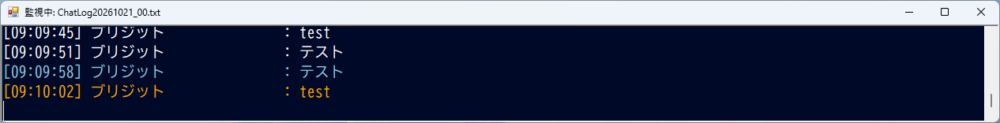

# PSO2NGS チャット表示ツール

PSO2 NGS のチャットログをリアルタイムで読み取り、別ウィンドウに見やすく表示するツールです。



> [!NOTE]
> これは個人が作成した**非公式ツール**です。株式会社セガおよび PSO2 NGS 運営とは一切関係ありません。
> ゲームのファイルやメモリには一切触れず、ゲームが出力するログファイル（テキスト）を読むだけです。

## できること

- 最新のチャットログを自動で見つけて、1秒ごとに新しい発言を表示
- 常に最前面に表示されるので、ゲーム画面の横や上に置いておける
- チャットの種類ごとに色分け

  | 種類 | 色 |
  | --- | --- |
  | 周囲 (PUBLIC) | 白 |
  | パーティー (PARTY) | 水色 |
  | ウィスパー (REPLY) | ピンク |
  | チーム (GUILD) | オレンジ |
  | グループ (GROUP) | 緑 |

- 指定したキーワード（「緊急」「募集中」など）を含む発言は背景を強調表示
- キャラクター名の幅を揃えて、発言が縦に揃うように表示
- 日付が変わってログファイルが切り替わっても自動で追従

## 使い方

1. [Releases](../../releases) から最新の `PSO2NGSチャット表示ツール.exe` をダウンロード
2. 好きなフォルダに置いてダブルクリックで起動
3. ゲームでチャットが流れると表示されます

> [!WARNING]
> PowerShell から作成した EXE のため、ウイルス対策ソフトに**誤検知**されることがあります。
> 気になる場合は、下の「.ps1 を直接使う」方法でソースコードのまま実行できます。中身はすべてこのページで確認できます。

### 設定を変える（任意）

`config.example.ini` を EXE と同じフォルダに置き、名前を `config.ini` に変えて編集してください。
置かなくても標準の設定で動きます。

| 項目 | 内容 |
| --- | --- |
| `LogPath` | ログフォルダの場所（通常は不要） |
| `FontType` / `FontSize` | 表示フォントと文字サイズ |
| `FormSize_X` / `FormSize_Y` | ウィンドウの幅と高さ |
| `Keywords` | 強調表示する言葉（カンマ区切り） |

※ `config.ini` は **BOM付き UTF-8** で保存してください（メモ帳なら「UTF-8 (BOM 付き)」）。

### .ps1 を直接使う

1. `PSO2NGS_ChatlogViewer.ps1` をダウンロード
2. PowerShell で次を実行（ダウンロードしたファイルのブロックを解除します）
   ```powershell
   Unblock-File .\PSO2NGS_ChatlogViewer.ps1
   ```
3. 右クリック →「PowerShell で実行」

## EXE の作り方（開発者向け）

[PS2EXE](https://github.com/MScholtes/PS2EXE) を使っています。

```powershell
Install-Module -Name ps2exe -Scope CurrentUser
ps2exe -inputFile ".\PSO2NGS_ChatlogViewer.ps1" `
       -outputFile ".\PSO2NGSチャット表示ツール.exe" `
       -iconFile ".\icon.ico" `
       -title "PSO2NGSチャット表示ツール" `
       -description "チャットログを監視して表示します" `
       -version "1.0.0.0" `
       -noConsole
```

## 動作環境

- Windows 10 / 11
- Windows PowerShell 5.1（Windows に標準で入っています）

## ライセンス

[MIT License](LICENSE)
